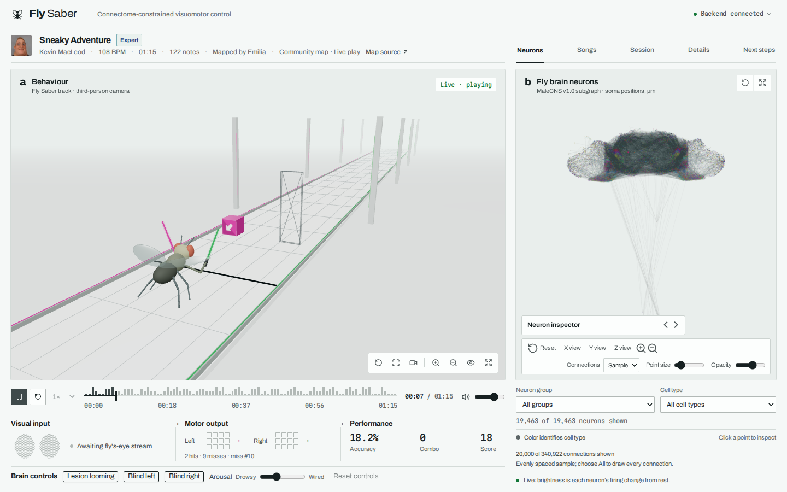

# Fly Saber

**A fruit fly brain built from the real connectome plays a rhythm game, and you can rewire it while it plays.**

[**Live demo**](https://flysaber.jackie-courtney.com) · [Results](results/README.md) · [Protocol](docs/PROTOCOL.md) · [Milestones](docs/project/MILESTONE.md) · [Spec](docs/project/FLY_SABER_HANDOFF.md)

[](https://github.com/jackie-0110/Fly-Saber/actions/workflows/ci.yml)



Fly Saber simulates 19,463 neurons and 340,922 connections from the visual-to-motor pathway of the [MaleCNS](https://male-cns.janelia.org/) connectome. The fly sees the incoming notes through its own compound eye, and its descending neurons swing two sabers, frame by frame, at 30 Hz.

While it plays you can watch every neuron fire in 3D and change the brain live: lesion the looming detectors, blindfold one eye, or turn arousal up and down, then watch the score and the neuron cloud respond. Pick almost any BeatSaver map, including songs the fly has never seen.

Built for SwampHacks.

## How it works

1. **Connectome.** `src/brain/connectome/` extracts a visual-to-motor subgraph from MaleCNS v1.0: photoreceptors through lamina, medulla and lobula to the visual projection neurons, then the descending neurons that drive movement. That's 19,463 neurons of 1,633 cell types and 6.2 million synapses, with neurotransmitter signs.
2. **Brain model.** `src/brain/model/brain.py` is a leaky rate network on that wiring. The connections stay fixed. Training sets each neuron's time constant, bias and output scale, one scale per pair of cell types, and a linear readout from the descending neurons to the sabers. Octopamine, dopamine and serotonin neurons scale the gain of the neurons they reach.
3. **Eye and game.** `src/fly_saber/` is a JAX game environment. The fly's eye samples the scene in 437 hexagonal columns (217 left, 220 right), luminance plus color, wired to the brain's own photoreceptor columns. Each saber picks a cell and a cut direction.
4. **Training.** `src/training/bc.py` uses behavior cloning: the fly imitates a scripted expert across community BeatSaver charts, trained on HiPerGator GPUs.
5. **Live play.** `src/server/` steps the trained brain at 30 Hz per session over a WebSocket, and streams saber actions, judged notes and per-neuron activity. Lesions, blindfolds and moods apply mid-song without recompiling.
6. **Browser.** `frontend/` (React and three.js) plays the song, renders the game, and lights the neuron cloud by each neuron's firing change from rest.

The wire format is in [`docs/PROTOCOL.md`](docs/PROTOCOL.md).

## Results

Greedy play, no expert help. Hit rate is notes hit over notes judged, on songs held out from training. The full tables, learning curves and caveats are in [`results/README.md`](results/README.md).

**Wiring variants** (seed 0, 256 windows of 10 s):

| Brain | Held-out hit rate |
|---|---|
| Real wiring, brain trained | 31.4% |
| Real wiring, readout only | 33.9% |
| Partners shuffled within layers | 51.8% |
| Excitation and inhibition shuffled | 20.0% |

**Live controls on the demo fly** (`bundles/real`, 64 windows of 10 s):

| Change | Held-out hit rate |
|---|---|
| None | 32.9% |
| Looming detectors (LPLC2, LC4, LPLC1, LPLC4) lesioned | 14.1% |
| One eye blindfolded | 7.1% to 7.6% |
| Motion detectors (T4, T5) lesioned | 2.1% |
| Both eyes blindfolded | 0% |

The fly plays from vision, and every visual lesion hurts. Shuffling partners within layers *beats* the real wiring. The likely reason is that the real circuit compresses vision into signals that matter to a fly (looming anywhere in view) and discards the where-on-screen detail this game rewards. The scripted expert scores 100% on every demo map.

## Quick start

Run the full demo locally. You need [uv](https://docs.astral.sh/uv/) and Node 22 (`nvm use`).

```bash
git clone https://github.com/jackie-0110/Fly-Saber.git && cd Fly-Saber
make setup    # locked Python 3.11 and frontend dependencies
make maps     # download the four CC BY demo songs from BeatSaver
make build    # build the front end into frontend/dist
make serve    # API, WebSocket and front end on http://localhost:8000
```

Open http://localhost:8000, choose a song, press play, and open the **Neurons** tab. The trained brains ship in `bundles/`, each with the exact subgraph it was trained on, so you don't need to download the connectome to play.

Or with Docker (CI builds and smoke-tests this image on every pull request):

```bash
make docker-build
docker run --rm -p 8000:8000 fly-saber:local
```

Deploying to a server is covered in [`docs/CI_CD.md`](docs/CI_CD.md).

## Development

```bash
cd frontend && npx playwright install --with-deps chromium && cd ..   # once
make check    # lint, strict types, pytest, frontend build, desktop and mobile browser tests
```

Daily commands: `make serve` (API on :8000), `make frontend` (Vite dev server on :5173), `make test`, `make lint`, `make fmt`. Tests use small synthetic graphs and maps, so they need no connectome, GPU, credentials or audio.

To rebuild the brain from scratch: `make data` downloads the MaleCNS files (about 1.2 GB, no account needed), `make subgraph` extracts the subgraph, and `make train-bc` trains, or use `infra/slurm/` on HiPerGator.

Pull requests run Python 3.11 and 3.12, the frontend, and a Docker smoke test in which the trained fly plays a full session inside the container. See [CONTRIBUTING.md](CONTRIBUTING.md) for the workflow.

## Repository layout

```text
src/                 Python packages: brain, fly_saber, training, server
frontend/
  src/app/           App entry point, shell and styles
  src/features/      Brain, game, session and songs code with their components
  src/components/    Shared UI primitives and presentation helpers
  src/lib/           Shared utilities and theme
  tests/, e2e/       Frontend unit and browser tests
scripts/             Maintenance commands grouped by data, connectome, training, web
infra/               Docker build and smoke fixtures, deployment scripts, SLURM jobs
configs/             YAML config for every component
bundles/             Trained brains with their exact subgraphs
data/                Raw downloads, processed data and song maps
results/             Training runs and control evaluations
docs/                Technical docs, project plans and frontend notes
tests/               Python tests, one folder per package
```

See [Repository guide](docs/REPOSITORY.md) for module boundaries, commands and file placement.

## Team

| Person | Focus | Owns |
|---|---|---|
| 1 | Brain and RL | `src/brain/`, training runs on HiPerGator, `results/`, hosting |
| 2 | Game, imitation, server | `src/fly_saber/`, `src/training/bc.py`, `src/server/` |
| 3 | Experience | `frontend/`, the demo |

Who builds what in detail: [`docs/project/FLY_SABER_TEAM_SPLIT.md`](docs/project/FLY_SABER_TEAM_SPLIT.md). Branches use the owner's prefix (`p1/`, `p2/`, `p3/`), and `main` always runs the demo.

## Documentation

| Doc | What |
|---|---|
| [`docs/project/FLY_SABER_HANDOFF.md`](docs/project/FLY_SABER_HANDOFF.md) | The full spec |
| [`docs/project/MILESTONE.md`](docs/project/MILESTONE.md) | What stands between us and the MVP |
| [`docs/PROTOCOL.md`](docs/PROTOCOL.md) | Map schema, `render_state`, WebSocket messages, interventions, activity stream |
| [`docs/DATA_NOTES.md`](docs/DATA_NOTES.md) | What the connectome files actually contain |
| [`docs/ARCHITECTURE.md`](docs/ARCHITECTURE.md) | Component boundaries and conventions |
| [`docs/CI_CD.md`](docs/CI_CD.md) | CI, the container image and deployment |
| [`results/README.md`](results/README.md) | Training runs, baselines and what each control does |

## Acknowledgements

- **Connectome:** [MaleCNS v1.0](https://male-cns.janelia.org/), Janelia FlyEM and collaborators, via [neuPrint](https://neuprint.janelia.org/).
- **Demo music:** "Sneaky Adventure", "Le Grand Chase", "Pop Goes the Weasel" and "Fluffing a Duck" by Kevin MacLeod ([incompetech.com](https://incompetech.com)), licensed under [CC BY 4.0](https://creativecommons.org/licenses/by/4.0/). Charts by their BeatSaver mappers, credited in the app.
- **Compute:** [HiPerGator](https://www.rc.ufl.edu/about/hipergator/), University of Florida Research Computing.
- Built with [JAX](https://github.com/jax-ml/jax), [FastAPI](https://fastapi.tiangolo.com/), [React](https://react.dev/) and [three.js](https://threejs.org/).

## License

No license has been chosen yet. Until one is added, ask the team before reusing the code. The connectome data and the music carry their own licenses (above).
