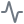

# Sidebar tab icons

This is the icon handoff for the Fly Saber dark/gray workspace. Keep the tabs in
the order below. Each symbol comes from the existing `lucide-react` dependency;
use the component name exactly as written.

| Symbol                                                                 | Tab label  | Lucide component | Tab value  | Meaning                                                                 |
| ---------------------------------------------------------------------- | ---------- | ---------------- | ---------- | ----------------------------------------------------------------------- |
|                            | Neurons    | `Brain`          | `activity` | Explore neuron locations, filters, and connections.                     |
|                   | Songs      | `Music2`         | `songs`    | Find and choose a song, difficulty, and fly brain.                      |
|                | Session    | `Activity`       | `session`  | Inspect the selected brain and live session status.                     |
|                       | Details    | `Info`           | `details`  | Read about the dataset, coordinates, connections, and view limitations. |
|  | Next steps | `ArrowUpRight`   | `next`     | Read the planned features and follow-on work.                           |

The `activity` value belongs to **Neurons**, despite its name. Keep the existing
tab values so the player store and tab panels continue to agree. **Next steps**
opens an in-page tab; its arrow is not an external-link action.

## Implementation

The composition lives in [brain-preview.tsx](../src/components/brain-preview.tsx),
using the existing [shadcn tab components](../src/components/ui/tabs.tsx).
Update the existing icon import and `TabsList`; keep the surrounding controlled
`Tabs` and its `TabsContent` panels in place.

```tsx
import { Activity, ArrowUpRight, Brain, Info, Music2 } from 'lucide-react'
import { TabsList, TabsTrigger } from '@/components/ui/tabs'

;<TabsList className="inspector-tabs" aria-label="Brain inspector view">
  <TabsTrigger value="activity">
    <Brain aria-hidden="true" />
    <span>Neurons</span>
  </TabsTrigger>
  <TabsTrigger value="songs">
    <Music2 aria-hidden="true" />
    <span>Songs</span>
  </TabsTrigger>
  <TabsTrigger value="session">
    <Activity aria-hidden="true" />
    <span>Session</span>
  </TabsTrigger>
  <TabsTrigger value="details">
    <Info aria-hidden="true" />
    <span>Details</span>
  </TabsTrigger>
  <TabsTrigger value="next">
    <ArrowUpRight aria-hidden="true" />
    <span>Next steps</span>
  </TabsTrigger>
</TabsList>
```

## Appearance and behavior

- Use 14 × 14 px icons with Lucide's default `strokeWidth={2}`. Keep the visible
  text labels; the icons supplement them.
- Above 1280 px viewport width, place each icon beside its label. At compact
  desktop and mobile widths, stack the icon above its label so all five remain
  visible. Keep desktop tab targets at least 44 px high and mobile targets 56 px.
- Style the tabs in [plate.css](../src/plate.css) using the palette tokens from
  [index.css](../src/index.css): inactive tabs use `--ink-3`; active text uses
  `--ink`, with `--focus` for the active icon and underline and `--brand-wash` for
  its background. These tokens belong to the dark/gray implementation, including
  its green accents.
- Keep icons decorative with `aria-hidden="true"`. The visible label supplies the
  accessible name. Preserve shadcn/Radix keyboard navigation and focus behavior.
- Check that ArrowRight moves through the five tabs in order, Home returns to
  Neurons, and every tab still has its visible label and matching panel.
- Check wide desktop, 1280 px, and 320 px layouts for clipping or horizontal
  overflow. Keep the light-mode branch as a separate saved option.

## Symbols and attribution

The five SVGs in [assets/sidebar-tabs](assets/sidebar-tabs/) are visual references
exported from the installed `lucide-react` 1.58.0 package. Their neutral gray stroke
keeps the previews readable on light and dark document backgrounds. In the app,
use the React components above and let the theme determine their color.

The SVGs retain Lucide's icon geometry. See the accompanying
[Lucide license](assets/sidebar-tabs/LICENSE) for attribution and terms.
