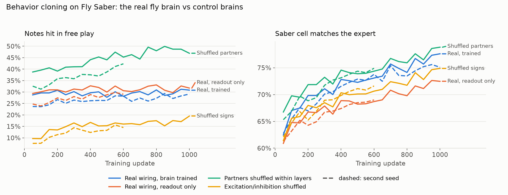

# Results

The trained fly plays unseen songs from vision alone, at about a third of notes hit, and every
visual lesion hurts it. Real wiring does not beat scrambled wiring: shuffling partners within
layers plays better. Every number below links to the run that produced it; differences of 2 to
3 points are within noise.

Hit rate is notes hit over notes judged (hits, misses and bad cuts), greedy play, no expert
help. Notes run at a fixed 7 m/s.

## The fly plays from vision

| Measure | Result | Source |
|---|---|---|
| Demo fly on held-out songs (`bundles/real`, update 950) | 32.9% | [`results/controls/eval_bc_950_full.json`](controls/eval_bc_950_full.json), 64 windows of 10 s |
| Same fly, both eyes blindfolded | 0% | `docs/project/MILESTONE.md`, "Fly plays from vision" |
| Same fly, all descending neurons lesioned | 0.0% | `eval_bc_950_full.json` |
| Scripted expert on the 10 demo maps | 100% (2,325 of 2,325 notes) | `docs/project/MILESTONE.md`, acceptance test 4 |

The fly plays unseen songs at least as well as training songs (31.4% held out, 28.4% training,
seed 0). Not yet measured: a random policy, which the spec's acceptance test asks the trained fly
to beat by a clear margin.

## Real versus scrambled wiring

Seed 0, 256 windows of 10 s, the same windows for every brain. Seed 1 runs stopped at 600 updates.
From [`results/README.md`](README.md).

| Brain | Held-out songs (seed 0 / 1) | Training songs (seed 0 / 1) |
|---|---|---|
| Real wiring, brain trained | 31.4% / 29.9% | 28.4% / 26.8% |
| Real wiring, readout only | 33.9% / 31.7% | 29.9% / 28.3% |
| Partners shuffled within layers | 51.8% / 44.4% | 46.2% / 39.9% |
| Excitation and inhibition shuffled | 20.0% / 17.0% | 17.9% / 16.0% |

Learning curves: [`figures/learning_curves.png`](../docs/figures/learning_curves.png), table in
[`figures/learning_curves.md`](../docs/figures/learning_curves.md).

Read honestly: wiring did not help. Shuffling excitation and inhibition roughly halves
performance, but shuffling partners within layers improves it. The likely reason is that the
real circuit compresses vision into signals that matter to a fly (looming anywhere in view) and
discards the where-on-screen detail this game rewards. Training the brain's own parameters did
not beat training the readout alone.

## Lesion matrix

Every lesionable section on the demo fly, held-out songs, 64 windows of 10 s, readout re-centred
for each condition as the server does. From
[`results/controls/eval_bc_950_full.json`](controls/eval_bc_950_full.json).

| Section lesioned | Neurons | Hit rate | Bad cuts | Bombs |
|---|---|---|---|---|
| None | | 32.9% | 50 | 14 |
| Dopamine neurons | 37 | 29.2% | 101 | 16 |
| Serotonin neurons | 12 | 18.8% | 67 | 20 |
| Giant fiber (DNp01) | 2 | 16.8% | 35 | 20 |
| Looming detectors (LPLC2, LC4, LPLC1, LPLC4) | 542 | 14.1% | 114 | 4 |
| Wide-field motion cells (HS, VS) | 42 | 10.6% | 119 | 20 |
| Right eye | 1,699 | 7.6% | 79 | 26 |
| Left eye | 1,526 | 7.1% | 15 | 18 |
| Visual feature detectors (LC neurons) | 4,253 | 6.1% | 53 | 13 |
| Octopamine neurons | 31 | 4.9% | 43 | 13 |
| Central brain relay | 2,479 | 3.0% | 225 | 13 |
| Motion detectors (T4, T5) | 3,383 | 2.1% | 63 | 5 |
| All descending neurons | 1,310 | 0.0% | 0 | 0 |

The spec's acceptance test holds: lesioning the looming detectors more than halves the hit rate.
It is not selective, though. Blinding either eye or removing the motion detectors drops the fly
nearly to nothing, so looming is one of the milder visual lesions.

## Mood sliders

Each mood drives its modulatory group (arousal octopamine, reward drive dopamine, calm
serotonin). From [`results/controls/moods_bc_950.json`](controls/moods_bc_950.json)
and `eval_bc_950_full.json`, held-out songs, 64 windows of 10 s.

| Mood | Levels | Hit rate | Bad cuts |
|---|---|---|---|
| Arousal | -1 / -0.3 / -0.15 / +0.15 / +0.3 / +0.5 / +1 | 4.8 / 6.0 / 14.5 / 33.8 / 23.2 / 8.8 / 5.4% | 43 / 62 / 73 / 79 / 124 / 306 / 111 |
| Reward drive | -1 / -0.5 / +0.15 / +0.5 / +1 | 29.2 / 29.1 / 17.2 / 16.7 / 9.7% | 100 / 108 / 47 / 92 / 372 |
| Calm | -1 / -0.5 / -0.15 / +0.15 / +0.5 / +1 | 18.4 / 18.2 / 33.2 / 27.6 / 14.8 / 12.9% | 72 / 68 / 47 / 91 / 65 / 81 |

| Preset | Moods | Hit rate | Bad cuts |
|---|---|---|---|
| Depressed | arousal -0.3, reward drive -0.3 | 8.9% | 65 |
| Anxious | arousal +0.3, calm -0.3 | 10.5% | 176 |
| Excited | arousal +0.3, reward drive +0.3 | 9.9% | 259 |
| Content | calm +0.3, reward drive +0.3 | 20.9% | 56 |

Validation against the predicted direction: raising arousal does make the fly swing more, with
bad cuts rising from 79 at +0.15 to 306 at +0.5. But arousal hurts in both directions, so there is
no setting that plays better than the untouched brain. Lowering reward drive barely matters. The
presets are combinations of the three neuromodulators, not emotions the connectome encodes.
Slider ranges in `configs/controls.yaml` stop where the fly stays playable.

## Stimulation and eye controls

Measured live on the served brain, one 15 s window per condition (about 55 notes), so these set
slider ranges rather than serve as an eval. From
[`results/controls/live_controls.md`](controls/live_controls.md).

| Control | Levels | Hit rate (untouched 34.5%) |
|---|---|---|
| Stimulate giant fiber (Trigger escape) | 5.0 | 26.4% |
| Blur | 2° / 4° / 6° / 10° | 20.4 / 13.0 / 5.7 / 0.0% |
| Facets lost | 10% / 20% | 11.1 / 0.0% |
| Visual noise | 0.02 / 0.05 / 0.1 / 0.15 | 18.5 / 12.7 / 7.3 / 3.6% |
| Neural noise | 0.002 to 0.5 | 0 to 1.9% |

The fly is very sensitive to degraded vision, so the page's eye sliders stop at 8° of blur, 25% of
facets lost and 0.15 of visual noise. Neural noise collapses play at any level, likely because the
readout divides descending-neuron rates by their tiny resting spread; the page offers it as an
on/off switch.

## Acceptance tests (spec section 18)

| Test | Status |
|---|---|
| Rewired graph preserves in- and out-degree for every neuron | Passes (`tests/brain/test_variants.py`) |
| v2 and v3 parsers agree on equivalent fixtures | Passes (`tests/fly_saber/test_maps.py`) |
| Scripted expert scores near 100 on every demo map | 100% |
| Trained fly beats a random policy on training and held-out maps | Not measured |
| Lesioning looming detectors measurably reduces hit rate | 32.9% to 14.1% |
| Live session holds 30 Hz with activity streaming on the deployed server | Not yet checked on the public host (milestone F2) |
| Replay mode works with the server off | Dropped (no replay fallback) |
| Public deployment contains only allowlisted audio | Dropped (milestone D5) |

## Caveats

This is a rate model, not a living fly. Glutamate is treated as inhibitory and the
neuromodulators act only through gain, both simplifications. Points place each neuron at its soma
or an estimate, and the eye maps ommatidia to photoreceptor columns by angle (`docs/DATA_NOTES.md`).
